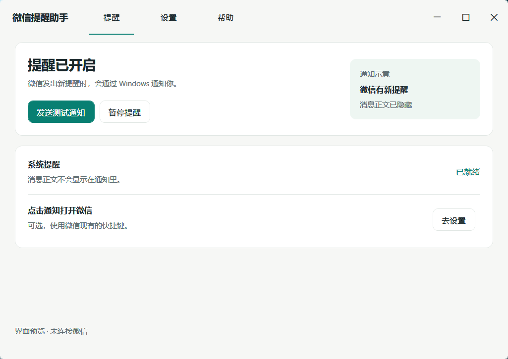
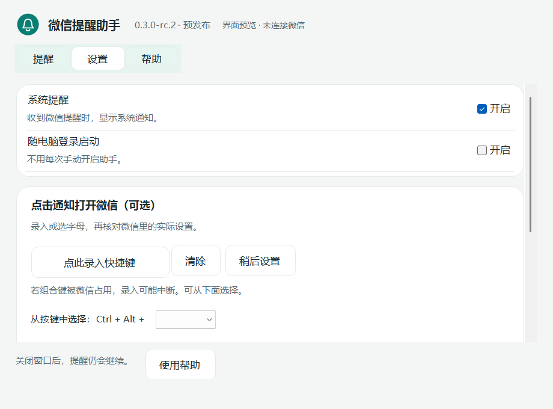
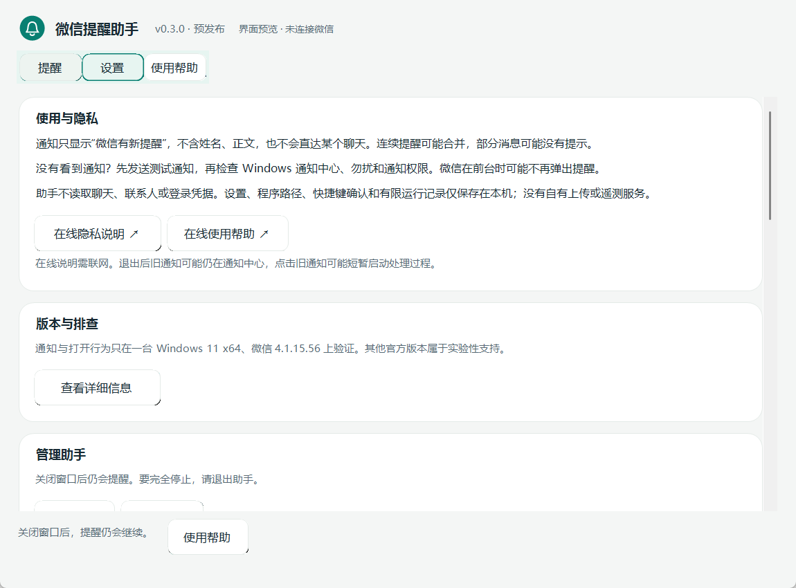

# WeChat Notification Helper

A small independent Windows utility that turns WeChat attention requests into Windows notifications. **Not an official WeChat product, replacement client, or UI modification.**

[中文与三步上手](README.md) · [Download](https://github.com/CanstaSolance/wechat-notification-helper/releases) · [Privacy](PRIVACY.md)

**0.3.0-rc.1 — control center refresh, prerelease.** Requires Windows x64 and **.NET 10 Desktop Runtime x64**. Windows 11 is recommended.

Screenshots use the real control center with an in-memory preview host, explicitly labeled in Chinese. They do not demonstrate successful message receipt. No preview configuration ships in the application.

## What it does

- Shows generic Windows notifications when verified WeChat processes request attention.
- Keeps sender names and message bodies out of notifications.
- Optionally uses a shortcut **you personally verify in WeChat** to bring an already-running WeChat forward when a notification is clicked.
- Runs as one background host without another tray icon. Settings open on demand.
- Makes startup at Windows sign-in optional.

It is **not a per-message API**: consecutive requests may merge, some messages may have no notification, and duplicates with WeChat remain possible. Foreground suppression, Windows notification settings and Do Not Disturb affect presentation. Clicks do not navigate to a particular conversation, start WeChat, or log you in.

## Get started

1. Download the **win-x64.zip** from [Releases](https://github.com/CanstaSolance/wechat-notification-helper/releases) and **extract all files**. Install [.NET 10 Desktop Runtime x64 from Microsoft](https://dotnet.microsoft.com/en-us/download/dotnet/10.0) if needed, not the SDK, ASP.NET runtime, or base runtime.
2. Run **Install.cmd**, open **提醒设置** (Notification settings), read the explanation, opt in, and save. The installer does not request administrator privileges or modify WeChat.
3. Click **测试提醒** (Test notification) in **概览** (Overview), check the Windows notification center, and keep your independently opened and signed-in WeChat running.

The package is unsigned. Compare SHA256SUMS.txt from the same release to check integrity; this does not replace trusting the source. Do not disable security software or enterprise protections if execution is blocked.

## Settings and help

**显示系统提醒** enables attention notifications. **登录电脑后自动准备** starts this helper at sign-in without launching WeChat. **点击通知，打开微信** is optional: personally check WeChat's actual show/hide-window shortcut, enter it and confirm. Do not copy a developer's binding. Supported: **Ctrl+Alt+letter**, optionally with Shift. Leave blank if uncertain.

Signature, exact file version/fingerprint, current-user and live-process gates remain in place. A WeChat update requires renewed confirmation. Repeated failures pause shortcut activation. No global hotkey is registered; the notification activation path never opens the hidden tray menu.

Installation location is normally automatic; expand the path section only if discovery fails or multiple installations exist. Choose the official program, never a chat directory. Save feedback appears inline; resetting unsaved edits does not roll back the installed application.

If a test does not pop up, check the notification center, Do Not Disturb and Windows permission for **微信提醒助手**. “Waiting for WeChat” means open it yourself. If a test works but messages are missed, the attention source cannot guarantee delivery. For click failures, recheck the actual shortcut and ensure WeChat is already running. Keep safety records intact.

## Close, exit, update and uninstall

Closing settings leaves an opted-in background host running. Reopen WeChatNotify.exe or its Start-menu entry to return to the same instance. **隐私与帮助 → 退出助手** exits with confirmation. Closing without first-use consent exits the candidate. Old Windows notifications may remain; clicking one can briefly launch a callback process without resuming background monitoring.

Install: **%LOCALAPPDATA%\Programs\WeChatNotify**. State: **%LOCALAPPDATA%\WeChatNotify**.

No automatic downloads: get a new package from Releases, extract it, run its Install.cmd. Verification and staging precede switching; one previous installation is kept. **Rollback.cmd** restores it if available. The older **0.2.0-rc.2** release remains downloadable.

Uninstall via **隐私与帮助 → 卸载助手**. Only owned registration, startup, known settings and verified package files are removed. Safety blocks and unknown/modified files are retained; uninstallation may stop. Portable program directories require manual deletion. WeChat and chat data are not removed.

## Support and privacy

Existing notification and shortcut behavior was accepted on **one Windows 11 x64 machine with official WeChat 4.1.15.56**. Other signed WeChat versions are experimental. Windows 10 has not completed real-machine validation; ARM64/x86 packages are not provided. This UI release does not claim fresh incoming-message, cross-machine, exhaustive DPI or long-duration acceptance. See [validation](docs/VALIDATION.md).

Read the [privacy notice](PRIVACY.md). This utility reads public process/window and installation metadata and stores limited local settings/status, which can contain personal paths or Windows identifiers. It does not read chats, contacts, databases or credentials. No proprietary telemetry, upload or update service is implemented. Windows and WeChat have their own network behavior.

[Report an issue](https://github.com/CanstaSolance/wechat-notification-helper/issues) with versions and steps only. Do not post chat screenshots, contact names, raw configuration or personal paths. GitHub issues are public.

[Build](docs/DEVELOPING.md) · [Changelog](CHANGELOG.md) · MIT © 2026 CanstaSolance · [Third-party notices](THIRD_PARTY_NOTICES.md)
