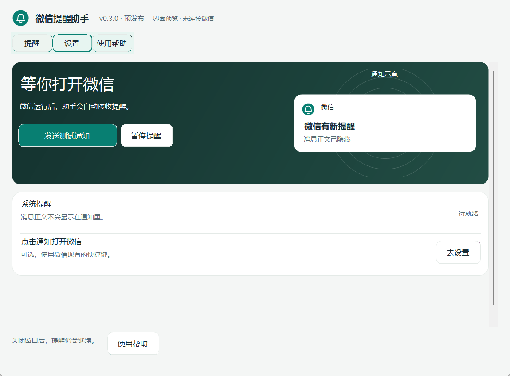
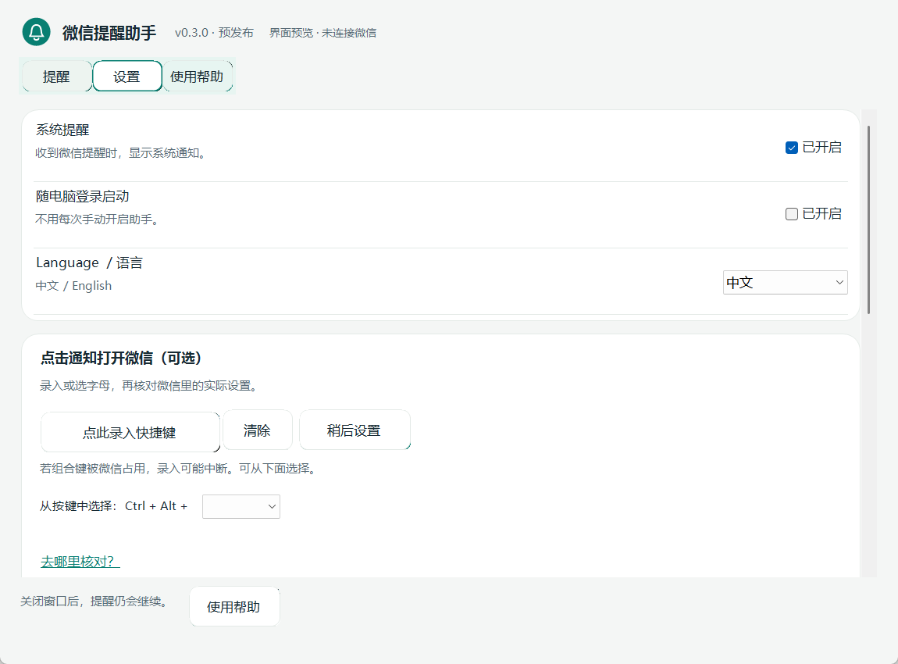
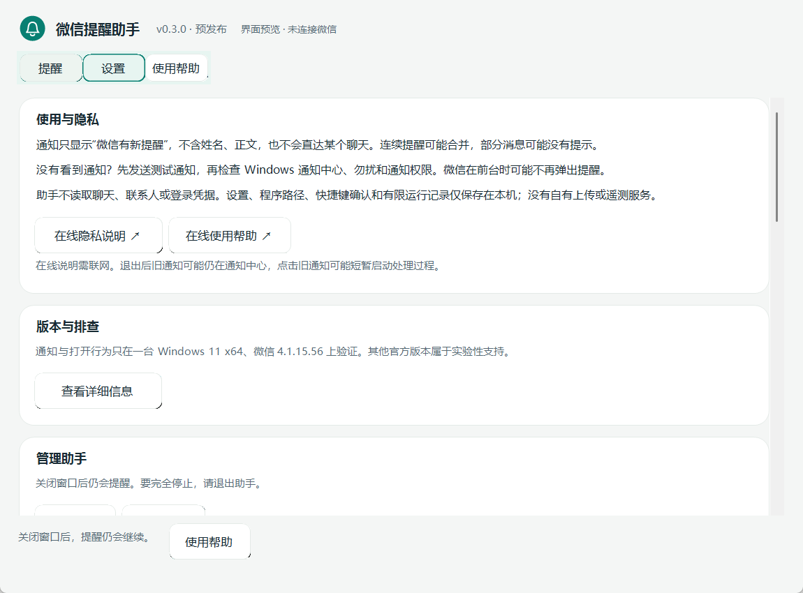

**中文 | [English: app, installation, privacy](README.en.md)**

同一应用可在设置的 Language / 语言中选择中文或 English，立即保存。已有用户保持中文。

# 微信提醒助手

**微信有新提醒时，在 Windows 通知里看见；设置好后，点一下回到微信。** 通知隐藏消息正文，助手不占用托盘图标。

[下载预发布版](https://github.com/CanstaSolance/wechat-notification-helper/releases) · [三步上手](#三步上手) · [隐私说明](PRIVACY.md) · [English](README.en.md)

> 这是独立、非官方工具。当前版本 **0.3.0（紧凑界面预发布）**。需要 Windows x64 和 **.NET 10 Desktop Runtime x64**。

截图使用演示状态，不含真实聊天或个人信息；发行程序不会自带演示设置。

## 能帮你做什么

- **看见系统提醒**：微信发出新提醒时，通过 Windows 通知你。
- **不展示聊天内容**：通知不包含发件人和正文。
- **可选的点击打开**：亲自确认微信快捷键后，点击通知可尝试打开已经运行的微信。
- **安静地待在后台**：没有额外托盘图标；暂停、恢复、退出都在控制中心。
- **你决定何时启用**：首次使用需要同意；随电脑登录启动由你选择。

**先了解边界：** 不能保证每条新消息都提醒。连续提醒可能合并，部分消息可能没有提示，也可能与微信自身提醒重复。微信在前台、Windows 勿扰或通知被禁用时，可能不弹出。点击通知不会直达某个聊天；微信没运行时，不会替你启动或登录。

## 三步上手

1. 从 [Releases](https://github.com/CanstaSolance/wechat-notification-helper/releases) 下载 **WeChatNotify-0.3.0-win-x64.zip**，先**全部解压**，不要从压缩包内运行。缺少运行环境时，从[微软官方下载页](https://dotnet.microsoft.com/en-us/download/dotnet/10.0)安装 **.NET Desktop Runtime 10，Windows x64**（不是 SDK、ASP.NET 或普通 Runtime）。
2. 双击解压文件夹里的 **Install.cmd**。进入“设置”，阅读说明、勾选同意并保存。安装器不请求管理员权限，也不修改微信。
3. 在“提醒”点击**发送测试通知**，检查 Windows 通知中心。然后让你已自行打开、登录的微信正常运行。发送测试通知只检查助手到 Windows 的通道，不证明每条微信消息都能收到。

当前发行包没有代码签名证书。安装前可对照同一 Release 的 **SHA256SUMS.txt** 检查下载是否完整；它不能取代可信来源判断。被系统或企业策略阻止时，不要关闭安全防护来运行。

## 设置

**系统提醒**：暂停后停止观察新的提醒。之前已经进入 Windows 通知中心的通知可能仍保留。

**随电脑登录启动**：可选。助手在后台运行，不会自动打开微信，也不会代你登录。

**点击通知打开微信**：可选，留空仍能接收提醒。在微信“设置 → 快捷键”中找“显示/隐藏窗口”，点击录入后按实际组合键，或从 A–Z 选择字母，再亲自确认。当前支持 **Ctrl+Alt+字母**，不支持 Shift。不要直接照抄别人或开发者的快捷键；如果找不到这项或不能确定，请留空。

微信更新或快捷键变更后需要重新核对。助手会核验官方签名、文件版本、文件指纹及当前 Windows 用户；环境不符合条件时不发送组合键。连续失败会停用点击打开功能。它不注册新的全局快捷键，也不展开隐藏托盘。

**微信安装位置**：通常自动识别。在找不到或有多个安装时展开，选择官方 Weixin.exe 或 WeChat.exe。这里选择的是程序，不是聊天文件夹。

保存结果显示在窗口内。“撤销”只丢弃未保存的编辑，不会恢复以前安装的版本。

## 没看到提醒怎么办

| 现象 | 可以先做什么 |
|---|---|
| 发送测试通知没有弹出 | 打开 Windows 通知中心；检查勿扰，以及“微信提醒助手”的通知权限。系统接受通知不等于一定弹窗。 |
| 显示“等你打开微信” | 自行打开微信。助手不会启动或登录微信。 |
| 显示“未能准备好提醒” | 重新保存；必要时选择官方程序。在“帮助”可展开技术信息。 |
| 发送测试通知有，但有些消息没有 | 不能保证逐条提醒。确认微信在后台、助手未暂停；不能保证补齐漏报。 |
| 点击通知没反应 | 微信必须已运行；核对实际快捷键。微信升级后重新确认。保护状态下请手动打开微信，不删除保护记录。 |
| 找不到助手窗口 | 再次打开安装目录的 WeChatNotify.exe，或开始菜单“微信提醒助手”。会回到同一后台实例。 |

安装目录为 **%LOCALAPPDATA%\Programs\WeChatNotify**；设置和有限状态位于 **%LOCALAPPDATA%\WeChatNotify**。技术状态可能包含个人路径或 Windows 用户标识，请不要直接上传原始配置。

## 关闭、退出和卸载

- **关闭窗口**：已启用时继续后台提醒。未同意启用时，关闭会退出。
- **完全停止**：“帮助 → 管理助手 → 退出助手”。退出会确认。旧通知可能仍在 Windows 通知中心；点击旧通知可能短暂启动通知处理过程，不等于重新开启后台提醒。
- **卸载**：在同一管理区点击“卸载助手”。只移除自己的注册、启动项、已知配置和经过清单校验的安装文件，不删除微信或聊天数据。未知、修改过或不安全的文件会保留，卸载可能因此停止。安全保护记录不会自动删除。便携目录的文件需手动清理，详见[隐私说明](PRIVACY.md)。

## 更新与回退

助手**不会自动下载更新**。新版本从本仓库 Releases 下载，全部解压后运行新的 Install.cmd。安装器先校验、暂存，再切换目录，保留一份上一安装用于回退。

如更新后有问题，从完整发行包运行 **Rollback.cmd** 可切回保留的上一安装（必须已有上一安装）。旧的 **0.2.0-rc.2** Release 也保留下载。回退不是恢复聊天数据，也不会移除安全保护。

微信更新后，提醒功能仍只能尽力工作；已确认快捷键绑定会因文件变化失效，需要你重新核对。没有“永久适配所有微信版本”的保证。

## 支持范围

建议 Windows 11 x64。Windows 10 **尚未完成实机验证**；不提供 ARM64 或 x86 发行包。

既有通知和点击打开行为仅在**一台 Windows 11 x64、官方微信 4.1.15.56** 上验证。其他官方签名版本属于实验性支持。0.3.0 重做控制中心和文档，保留通知引擎与打开逻辑；这不是新的真实来信或跨机器兼容性验收。完整范围见[验证记录](docs/VALIDATION.md)。

## 隐私与反馈

请先看[完整隐私说明](PRIVACY.md)：读取什么、保存在哪里、何时发送已确认的组合键，以及 Windows 通知和卸载的边界。本工具没有自有上传、遥测或更新服务器。

[反馈问题](https://github.com/CanstaSolance/wechat-notification-helper/issues)：请提供助手版本、Windows 版本、微信版本（不要账号）、操作步骤、预期与实际结果。不要附聊天截图、联系人名称、原始配置或带个人路径的日志。GitHub 问题公开可见，请先检查内容。

[开发与构建](docs/DEVELOPING.md) · [更新记录](CHANGELOG.md) · MIT © 2026 CanstaSolance · [第三方许可](THIRD_PARTY_NOTICES.md)

### 0.3.0 快捷键录入

在“设置”点录入按钮，再按微信现有的 Ctrl + Alt + A–Z。松开字母键后显示键帽。Esc、Tab、失焦或约12秒未完成会取消，不保存。微信全局快捷键可能抢先响应，让录入中断；此时直接用“从按键中选择”下拉框选 A–Z，不必手敲，也不会代你发送按键。

仅支持 Ctrl + Alt + 字母，不支持 Shift。录入不等于核实微信设置；首次建立、修改或微信更新后重建绑定时仍需亲自确认。取消录入和普通提醒选项保存不改变既有绑定。清除快捷键会停用并清空该绑定，不影响提醒设置。
尚未核对快捷键时，可点“稍后设置”：放下这次快捷键改动，只保存其他提醒选项，既有绑定不会被覆盖。

This v0.3.0 repaint/language revision updates the existing release. The v0.3.0-rc.2 tag and automatic Source code archive remain historical. For exact current sources, use the new v0.3.0 source.zip and SHA256SUMS.txt, or the reviewed main commit. Build provenance and exact source-file hashes are in build-manifest.json.
